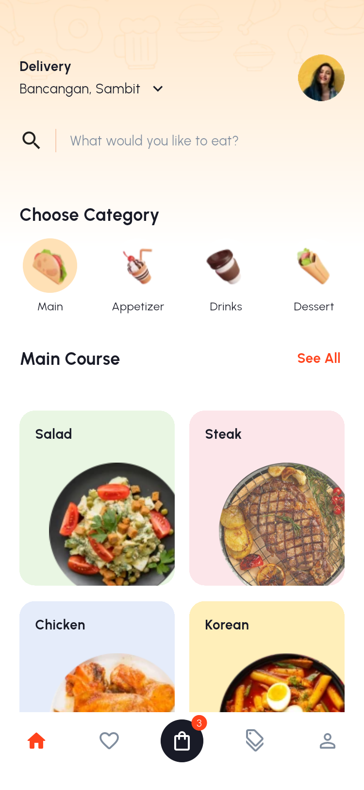
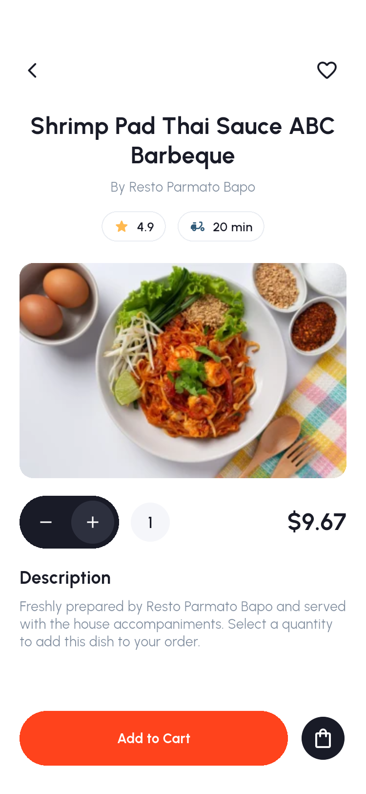
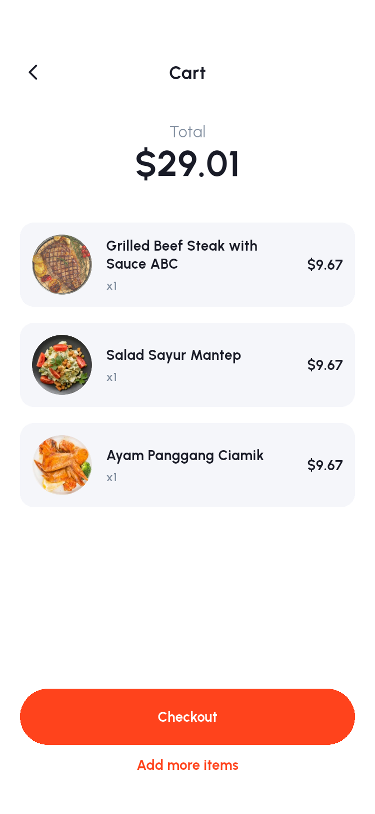
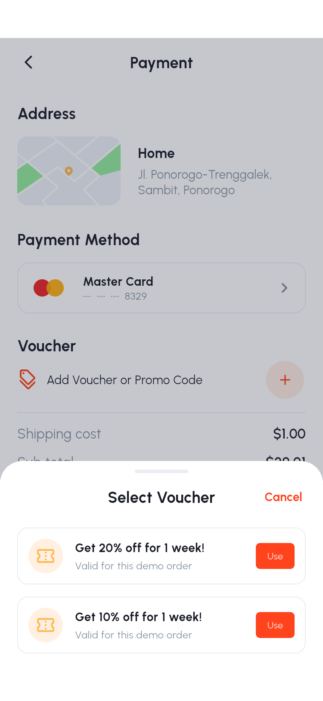
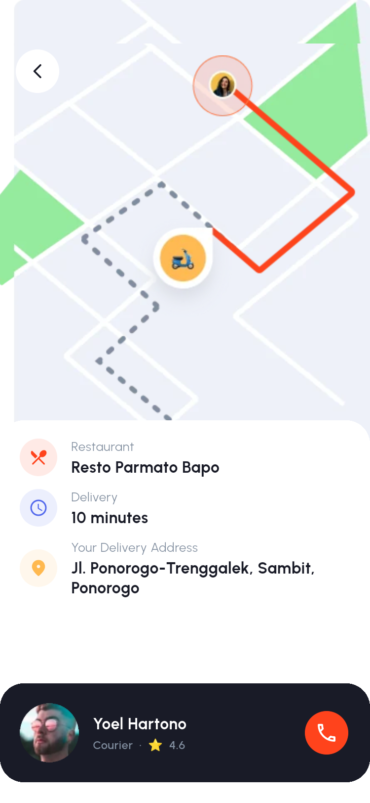
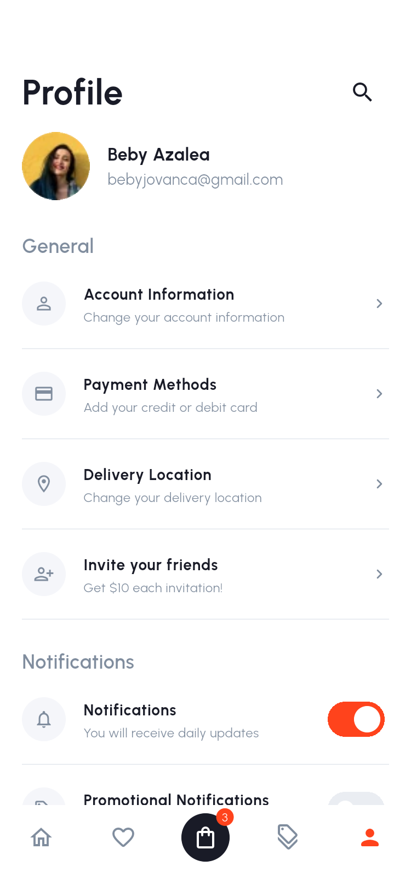

# Lezatos · Flutter 外卖 App

Lezatos 根据 Pixso 的 **Lezatos - Food Delivery Apps** 实现。MCP 读取了 `Visual` 分类的 41 个手机画板，以及 `Design Style` 下的 Colors、Typography 和 Component。界面沿用英文文案与 Urbanist 字体，运行目标为 Android。

## 主要界面

下面是 Flutter 应用在 Android 模拟器上的实跑截图。全部画板、Pixso 节点 ID 与截图见 [界面索引](docs/SCREENS.md)。

| 首页 · 分类浏览 | 菜品详情 | 购物车 |
| --- | --- | --- |
|  |  |  |

| 付款 · 优惠券 | 配送追踪 | 个人中心 |
| --- | --- | --- |
|  |  |  |

## 可体验的流程

- 启动、三步引导、登录、注册、邮箱或手机验证码以及密码重置。登录可输入 `demo@lezatos.app` 和 `demo123`，验证码为 `5123`。
- 浏览菜单、搜索菜品、收藏与取消收藏、设置配送地点。在 **Profile → Appearance** 可切换 3 种首页、3 种菜品详情和 2 种收藏布局。
- 选择数量和加入购物车，应用优惠券、选择示例支付卡并提交演示订单。点购物车中的商品可以修改数量或删除，配送页可查看示例路线和骑手信息。
- 编辑个人资料、管理示例支付卡、切换通知选项，浏览活动与通知。

账号和验证码按本地演示规则校验。购物车、收藏、偏好和订单记录保存在当前进程，重启后恢复示例初始状态。付款、地图、第三方登录和通知使用本地演示数据。新增示例卡片只保留卡组织与后四位，金额按商品单价、数量、配送费和优惠实时计算。

## 项目结构与架构

```text
LezatosFoodDelivery/
├─ lib/
│  ├─ main.dart                   # Flutter 启动
│  ├─ app.dart                    # 主题、页面路由、底部导航和系统安全区
│  ├─ core/
│  │  ├─ session.dart              # 会话、返回历史、购物车、订单与偏好
│  │  └─ ui.dart                   # 色板、文本、按钮、输入框、工具栏
│  ├─ data/
│  │  ├─ design.dart               # 41 个画板与 Pixso 节点 ID
│  │  └─ catalog.dart              # 菜单、示例卡、活动和金额格式化
│  └─ features/
│     ├─ auth.dart                 # 引导、登录、注册、验证码和密码重置
│     ├─ discovery.dart            # 首页、搜索、收藏、活动和通知
│     ├─ food_details.dart         # 菜品详情布局、收藏和数量选择
│     ├─ location.dart             # 位置搜索、快捷地址与地图预览
│     ├─ orders.dart               # 购物车、优惠券、付款与配送
│     └─ profile.dart              # 资料、地址编辑、卡片管理和偏好
├─ assets/
│  ├─ images/                     # Pixso 插画、菜品照片、地图与品牌素材
│  └─ fonts/                      # Urbanist 字体和 OFL 许可证
├─ android/                       # Android 工程、应用名和启动图标
├─ test/                          # 购物车金额和下单状态测试
├─ integration_test/              # Android 主流程测试及 41 个画板渲染
├─ test_driver/                   # 将实跑截图写入项目
├─ tool/capture.ps1               # 复用现有 Android 设备并恢复显示设置
└─ docs/
   ├─ SCREENS.md                  # 画板与截图索引
   └─ screenshots/                # Android 实跑截图
```

项目按功能拆分页面。`Session` 使用 `ChangeNotifier` 维护共享状态，`LezatosApp` 监听状态变化并根据 `Screen` 分发页面。表单、导航、列表与弹层使用 Flutter 控件，视觉资源以 WebP 打包，应用无需联网即可完成演示流程。运行时依赖仅为 Flutter SDK。

## 运行与验证

使用 Flutter 3.47.7 / Dart 3.13.5。Android 工程使用本机验证过的 Gradle 8.14 和 AGP 8.13.1。将示例设备 ID 换成 `flutter devices` 中的现有 Android 设备 ID。

```powershell
flutter pub get
flutter devices
flutter run -d emulator-5554
flutter analyze
flutter test
```

截图脚本会在现有 Android 设备上运行主流程测试并逐页截图，结束后恢复设备的分辨率和密度。仓库内截图来自 Android 11 x64 模拟器。

```powershell
powershell -ExecutionPolicy Bypass -File tool/capture.ps1 -Device emulator-5554
```

主要界面的并排展示参考 [Streamero README](https://github.com/282207134/StreameroStreaming/blob/main/README.md)。

